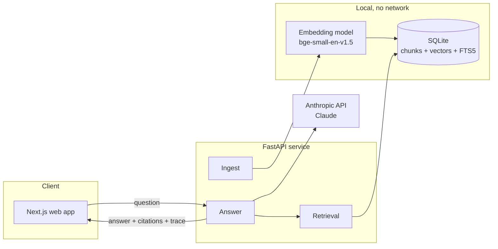
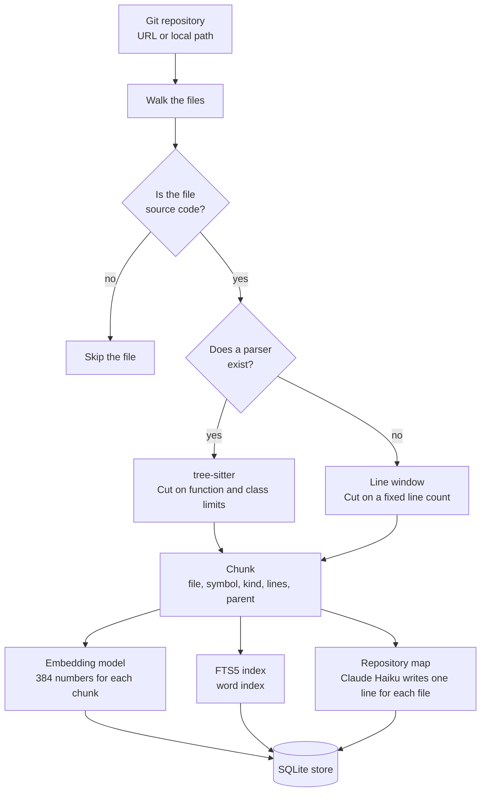
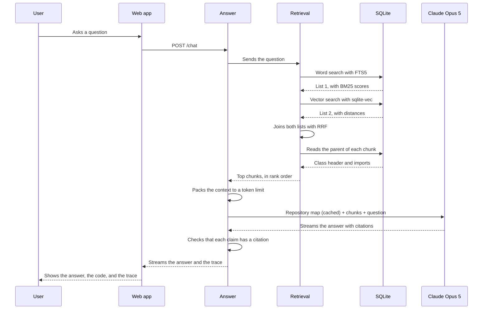

# Architecture

## 1. Purpose

This document shows how the Code Documentation Assistant works.
It shows the parts of the system and the flow of data between them.
We write this document in Simplified Technical English (ASD-STE100).

## 2. System overview

The system has two flows.
The ingest flow reads a repository and fills the store.
The question flow reads the store and makes an answer.

## 3. The ingest flow

The ingest flow runs one time for each repository.
It takes about 5 seconds for a repository with 2000 chunks.

## 4. The question flow

The question flow runs for each question.

## 5. The parts of the system

| Part | Job | Input | Output |
|---|---|---|---|
| Walk | Finds the source files. Skips binary files and large files. | A repository path | A list of files |
| Chunker | Cuts each file into chunks on syntax limits. | A source file | Chunks with metadata |
| Embedder | Makes a vector for each chunk. Runs on the CPU. | A chunk | 384 numbers |
| Store | Keeps the chunks, the vectors, and the word index in one file. | Chunks and vectors | Search results |
| Retrieval | Runs both searches. Joins the results with RRF. | A question | Ranked chunks |
| Context packer | Puts the chunks in the prompt. Keeps below the token limit. | Ranked chunks | A prompt |
| Answer | Calls Claude. Checks the citations. Makes the trace. | A prompt | An answer and a trace |
| Trace | Records the chunks, the scores, the tokens, the cost, and the time. | One question | A trace record |

## 6. Why the retrieval has two searches

A user asks about code in two different ways.

| The user asks | Example | The search that finds it |
|---|---|---|
| With an exact name | "Where is `retry_with_backoff`?" | Word search. The name is an exact token. |
| With intent | "How does the client repeat a failed call?" | Vector search. The words do not match the code. |

One search alone fails for one of these two cases.
RRF joins both result lists. A chunk that is high in both lists moves to the top.

## 7. Guardrails

| Risk | Control |
|---|---|
| The model invents an answer. | The prompt gives only the chunks. The model must refuse if the chunks do not hold the answer. |
| The answer has no proof. | Each claim needs a citation. We remove a claim that has no citation. |
| Source code holds an attack in a comment. | We mark all repository text as data. The model must not obey text inside a chunk. |
| The repository is too large. | We set a limit for the file count and the file size. |
