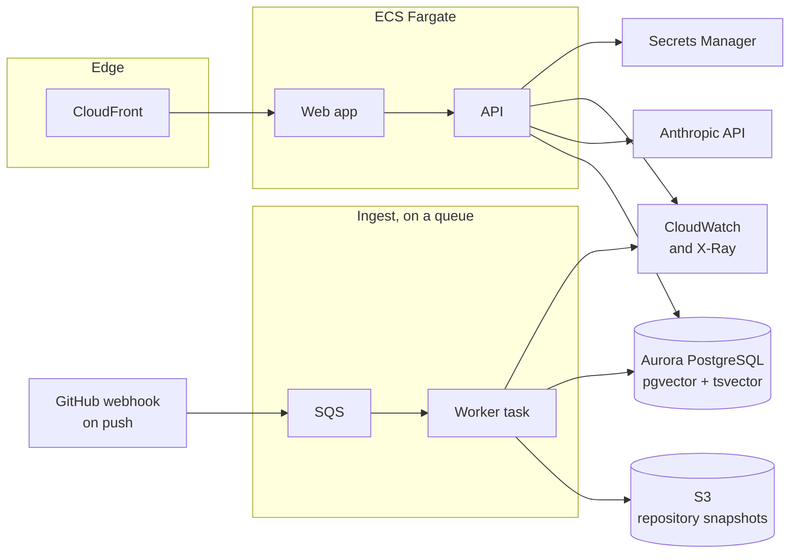

# From this build to production

## 1. Purpose

This document states what this build is now, what stops it from serving real users,
and the order in which we would fix that. Every number comes from
[evidence.md](evidence.md).

## 2. What this build is now

One machine. One index file. One user at a time.

| Property | Now |
|---|---|
| Store | One SQLite file on a disk |
| Ingest | A command that a person runs and waits for |
| Embedding | The local CPU, 12.5 chunks each second |
| Users | No sign-in, no accounts, no limits |
| State | None. A page reload loses the conversation |
| Secrets | One key in a `.env` file |

The shape is correct for a take-home build. Each part above is also a gap.

## 3. What stops it from serving real users

| Gap | The evidence | The effect |
|---|---|---|
| One writer | SQLite allows one writer at a time | Two repositories cannot index together |
| A local file | The index lives beside the container | A second copy of the API cannot read it |
| Slow embedding | 2453 chunks took 200 seconds | A repository of 50000 chunks takes over an hour |
| A command, not a job | The CLI runs in the foreground | A fault loses the work, and nobody sees the progress |
| No tenancy | Every reader sees one index | A second customer needs a second machine |
| No limits | Any caller may ask any number of questions | One caller can spend the whole budget |
| A large image | The API image is 1.09 GB | A cold start is slow, and a serverless host is costly |
| No history | The page holds the turns in memory | A reader loses the thread on reload |

## 4. The target shape

We would run this on AWS. The same parts exist on the other providers, and
section 8 names them.

| Part | Choice | Reason |
|---|---|---|
| Store | Aurora PostgreSQL with `pgvector` | ADR 0005 maps each column. The RRF step does not change. |
| Word index | `tsvector` and `ts_rank` | One query joins the word match and the vector match. |
| Ingest | SQS and a worker task | A job may retry. A reader may watch the progress. |
| Repository copy | S3 | A re-index needs no second clone. |
| Compute | ECS Fargate | The image is 1.09 GB, which suits a long-lived task, not a function. |
| Secrets | Secrets Manager | The key leaves the file and the image. |
| Measurement | OpenTelemetry to CloudWatch and X-Ray | The trace object already holds the fields. |

## 5. The index at scale

The retrieval design survives the move. Only the store changes.

| Question | Answer |
|---|---|
| Does an exact vector scan still work? | Up to about one hundred thousand chunks. Above that, add an HNSW index in pgvector. |
| How do we hold many repositories? | One table, with a repository column on every row, and that column first in each index. |
| Does the word search hold? | `tsvector` holds for a medium corpus. A large one needs OpenSearch, which also gives BM25. |
| Does the join change? | No. RRF reads ranks, so it does not care which engine produced them. |

The embedding step is the real limit. Three ways forward, in order of cost:

1. Keep the local model, and run many worker tasks. The work splits by file.
2. Move to a GPU task for the first index of a large repository.
3. Move to a hosted embedding model, and accept a bill for each ingest.

We would start with 1, because the model is small and the work is simple to split.

## 6. Cost

| Item | Measured | At one thousand questions each day |
|---|---|---|
| A question, cache warm | $0.033 to $0.065 | $33 to $65 each day |
| A question, cache cold | $0.123 | The first question of each repository |
| Embedding | $0, on our own CPU | Compute time only |

The cache holds the rules and the repository map, and it cuts the cost by about
60 percent. Two more controls belong in production:

- A budget for each account, with a hard stop.
- A cache for the answer, keyed by the repository commit and the question. A repository
  does not change between two readers who ask the same thing.

## 7. The order of work

We would not do all of this at once. This order gives the most value first.

| Step | Work | Why first |
|---|---|---|
| 1 | Move the store to Aurora with pgvector | Every other step needs a shared store |
| 2 | Put ingest on a queue, with a job record | Makes the work visible and repeatable |
| 3 | Add accounts, and a repository column on every row | Two customers cannot share one index |
| 4 | Add Secrets Manager and a budget for each account | Protects the key and the bill |
| 5 | Send the trace to OpenTelemetry | The fields already exist. Only the sink changes. |
| 6 | Run `make eval` on each change | It is free, so it can gate a merge |
| 7 | Cut the image in two stages | A smaller image gives a faster start |
| 8 | Store the conversation | A reader keeps the thread |

Steps 1 and 2 are most of the work. Steps 5 and 6 are nearly free, because the trace
and the eval set already exist.

## 8. The same shape elsewhere

| Part | AWS | GCP | Azure | Cloudflare |
|---|---|---|---|---|
| Store | Aurora, pgvector | Cloud SQL, pgvector | Database for PostgreSQL | D1 with Vectorize |
| Queue | SQS | Pub/Sub | Service Bus | Queues |
| Compute | Fargate | Cloud Run | Container Apps | Workers, with a container for ingest |
| Objects | S3 | Cloud Storage | Blob Storage | R2 |
| Secrets | Secrets Manager | Secret Manager | Key Vault | Secrets |

Cloudflare suits the web app well. The ingest step needs more memory and time than a
worker allows, so it would run elsewhere.

## 9. What we would not build yet

| Not yet | Reason |
|---|---|
| A reranking model | The join already reaches every target by the third result. See ADR 0015. |
| A second LLM to check each answer | It doubles the cost for each question. The citation check is cheap and catches the common fault. |
| A vector database service | The corpus is bounded for each repository, and one store for both searches is simpler. |
| Fine tuning | Retrieval and the prompt carry the quality. Neither is exhausted. |
